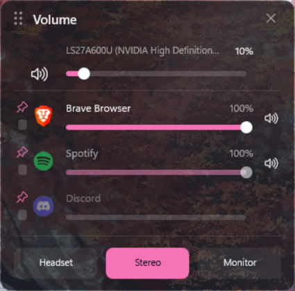
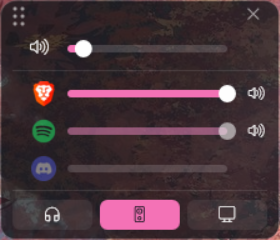

# Mixdock

A compact [Rainmeter](https://www.rainmeter.net/) skin to set the volume of individual apps and to switch the default audio output on Windows 11, without opening the Windows settings. Leave it on a corner of a screen while you play or work.

| Full layout | Compact layout |
| --- | --- |
|  |  |

## Features

- A volume slider, mute button and icon for every app that plays sound, with the master volume of the active output on top. An app with several audio sessions (a browser with several tabs) moves as one.
- Three output buttons that switch the Windows default playback device, which you map to your own devices.
- Pin the apps you always want (their row stays, dimmed while silent) and reorder them by dragging a small grip. Apps that are not playing are dimmed.
- Drag a slider, click on it, or use the mouse wheel (5% per notch).
- A full and a compact layout, a highlight color that follows the Windows accent color (or any color you choose), and adjustable opacity, all from the right-click menu.
- Light on resources: nothing runs while the skin is closed, and it uses a fraction of a percent of one CPU core while open.

## Requirements

- Windows 11 (the icons use the *Segoe Fluent Icons* font that comes with it)
- [Rainmeter](https://www.rainmeter.net/) 4.5 or newer
- To build from source: nothing else, the C# compiler that ships with Windows is enough

## Install

**From a release.** Download `Mixdock-<version>.zip` from the Releases page, extract the `Mixdock` folder into your Rainmeter skins folder (by default `Documents\Rainmeter\Skins`), refresh Rainmeter, and load `Mixdock\Mixdock.ini`. The package includes the compiled helper. Windows SmartScreen may warn about it because the program is not code-signed; you can build it yourself from the source in this repository instead.

**From source.** Clone the repository, point Rainmeter's skin path at its `Skins` folder (or copy `Skins\Mixdock` into your skins folder), run `helper\build.ps1` in PowerShell, then load `Mixdock\Mixdock.ini`. The build needs no SDK.

## Set up your outputs

The first time the helper runs it creates `Helper\config.json` from `config.example.json`. Open it and make each output match part of the name of one of your playback devices (see the list in the Windows sound settings):

```json
{
  "devices": [
    { "alias": "headset", "label": "Headset", "match": "Headset", "icon": "headset" },
    { "alias": "stereo", "label": "Stereo", "match": "Speakers", "icon": "speakers" },
    { "alias": "monitor", "label": "Monitor", "match": "HDMI", "icon": "monitor" }
  ],
  "pinned": [ "Discord" ],
  "exclude": [],
  "graceSeconds": 60
}
```

- `match` is a part of the device name, without regard to case. The three outputs become the three buttons.
- `icon` is optional and used by the compact layout: `headset`, `speakers`, `monitor`, `jack` or `gamepad`. Without it the button shows the output's number.
- `pinned` lists apps (process names without `.exe`) that always stay in the list while they run. You can also pin from the panel; the list is kept in order.
- `exclude` lists apps to hide for good, and `graceSeconds` is how long an app stays listed after it stops playing.

## Using it

- **Move the panel** by its grip (the dots in the top-left corner). The rest of the panel never moves it.
- **Volume**: drag or click a slider, or scroll over a row. The speaker button mutes.
- **Pin** an app with the small pin left of its icon (grey when off, bright when on). **Reorder** apps inside their group (pinned apps, other apps) by dragging the square under the pin.
- **Output**: click one of the three buttons at the bottom.
- **Close** with the cross in the corner (the helper stops with it).

## Settings

Right-click the panel and open **Custom skin actions**:

- **Layout**: *Full* (names, percentages, labelled output buttons) or *Compact* (icons and sliders only; an app's name shows as a tooltip on its icon, the percentage replaces the mute button while you drag a slider, the pin and the grip show only while the cursor is over the panel, and the output buttons are small icons).
- **Accent**: the highlight color. By default it follows the Windows accent color and changes with it. Pick a preset, or choose *Custom* to type any color in the settings file (`RRGGBB`, for example `3B82F6`, or `r,g,b`).
- **Opacity**: from 100% (solid) down to 50%.
- **Open settings file**: opens `Settings.inc`, which the menu writes and you can also edit by hand. It is created on the first change. The built-in defaults live in `Theme.inc` (colors, fonts), `Layout-full.inc` and `Layout-compact.inc` (positions and sizes).

## How it works

Rainmeter cannot read or set the volume of a single app, so the skin only draws the panel while a small helper program (`MixdockHelper.exe`, written in C# on the Windows Core Audio API) does the audio work. The helper writes the state of your apps and outputs to a JSON file that the skin reads, and the skin sends commands (set a volume, mute, switch output, pin) as small files that the helper picks up immediately. Dragging is followed by the helper itself, because Rainmeter reports the mouse position only inside a click. Switching the default output uses an undocumented Windows interface (`IPolicyConfig`), isolated in one file, which a future Windows update could change. See [docs/spec.md](docs/spec.md) for the design.

## Troubleshooting

- *"Waiting for the helper"*: the helper is missing. Run `helper\build.ps1`, or use the release package.
- *An output button is dimmed or does nothing*: no active playback device matches its `match` text. Check the name in the Windows sound settings.
- *The list shows only some apps*: an app appears while it plays, for `graceSeconds` afterwards, or when pinned; the panel lists the first six.
- To see everything the helper reports: `Helper\MixdockHelper.exe dump --stdout --all`.

## Contributing and packaging

The repository layout, the build, and how a release is made are described in [docs/packaging.md](docs/packaging.md).

## License

MIT, see [LICENSE](LICENSE).
